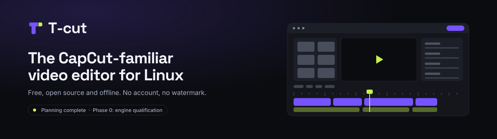

<picture>
  <source media="(prefers-color-scheme: light)" srcset="docs/assets/brand/banner-light.svg">
  <source media="(prefers-color-scheme: dark)" srcset="docs/assets/brand/banner.svg">
  
</picture>

<p align="center">
  <strong>Linux first · Rust + GTK4 · GPL-3.0-or-later</strong><br>
  <a href="https://twarga.github.io/T-cut/">Website</a> ·
  <a href="docs/plan/release-roadmap.md">Roadmap</a> ·
  <a href="https://twarga.github.io/T-cut/brand/">Brand kit</a> ·
  <a href="https://github.com/Twarga/T-cut/issues">Discuss an idea</a>
</p>

# T-cut

**A free, open-source video editor planned for Linux, with a workflow familiar to CapCut Desktop users.**

> **Coming soon.** Plans, brand, and website are done. **The editor is not built yet.** There is nothing to download.

## Start here

| If you want to... | Go to |
|---|---|
| Get the short version | [Website](https://twarga.github.io/T-cut/) |
| See each version | [Release roadmap](docs/plan/release-roadmap.md) |
| Start the first task | [Phase 0 plan](docs/plan/starter-plan.md) |
| Use the logo or colors | [Brand guide](docs/brand/brand-guidelines.md) |
| Help out | [Contributing](CONTRIBUTING.md) |

## What it will be

- **Offline.** No account, subscription, watermark, ads, or paid unlocks.
- **Familiar.** Home, projects, editor, and export work the way CapCut users expect.
- **Its own.** Original name, logo, icons, and licensed assets.

## Releases

| Phase | Release | What you get |
|---|---|---|
| 0 · Test the foundation | Internal only | Prove playback and export, pick one media engine |
| 1 · Basic editor | **v0.1** | Projects, import, trim, move, titles, music, save, export |
| 2 · Everyday editing | **v0.2** | Snapping, richer text and audio, manual subtitles |
| 3 · Creator tools | **v0.3** | Animation, speed, transitions, masks, color, recording |
| 4 · Local AI | **v0.4** | Optional translation, tracking, cutout, cleanup |
| 5 · Stable | **v1.0** | Tested workflows, documented hardware and media, safe upgrades |

**No release dates.** AI features need models with verified rights. Cloud features come later, behind their own gates. Full details: [release roadmap](docs/plan/release-roadmap.md).

## Stack

| Job | Technology |
|---|---|
| Project state, editing, undo | Rust 2024 |
| Interface | GTK4 (Rust bindings) |
| Playback and render | GStreamer / GES, conditional on Phase 0 |
| Text | Pango, HarfBuzz, FreeType |
| Project files | Readable JSON snapshots plus a journal |
| Distribution | Flatpak first |
| Optional AI | Isolated local workers, license-checked models |

<details>
<summary><strong>Why is the video engine still conditional?</strong></summary>

An early CLI render of a 4-second, 30 fps timeline produced **121 frames (4.033333 s)** instead of 120. Phase 0 must explain and fix that, or reject the engine. Dropping the last frame is not a valid fix.

Details: [starter plan](docs/plan/starter-plan.md).

</details>

## Brand and themes

The **cut T** mark pairs violet with a lime slice. Two themes: **Ink** (dark) and **Paper** (light).

- [Brand guidelines](docs/brand/brand-guidelines.md)
- [Design system](docs/brand/design-system.md)
- [Theme tokens](docs/assets/tokens.css)

## Run the website locally

You need Python 3. No Rust or Node.

```sh
git clone https://github.com/Twarga/T-cut.git
cd T-cut
python3 -m http.server 8000 --directory docs
```

Open http://localhost:8000/. This runs the website, not the editor.

<details>
<summary><strong>All planning and research docs</strong></summary>

**Plan**

- [Master plan](docs/plan/README.md)
- [Release roadmap](docs/plan/release-roadmap.md)
- [Product spec](docs/plan/product-spec.md)
- [Architecture](docs/plan/architecture.md)
- [40 work packages](docs/plan/implementation.md)
- [Phase 0 starter plan](docs/plan/starter-plan.md)
- [UI contract](docs/plan/ui-contract.md)
- [Quality and release gates](docs/plan/quality-release.md)
- [Sources and evidence](docs/plan/sources.md)

**Research**

- [CapCut Desktop UI study](docs/research/research.md)
- [28-screenshot index](docs/research/screenshot-index.md)
- [24 screen states, 14 scenarios](docs/research/fidelity-contract.md)
- [Landing-page reference](docs/research/landing-page-study.md)

The desktop study used public screenshots from different versions. No CapCut build was run. A compatibility claim needs testing against a pinned build.

</details>

## Contribute and license

- Contribute: [CONTRIBUTING.md](CONTRIBUTING.md). Review website changes with real browser screenshots and keyboard checks.
- Security: [SECURITY.md](SECURITY.md).
- License: original code is **GPL-3.0-or-later** ([LICENSE](LICENSE)). Bundled fonts keep **SIL OFL-1.1** ([notices](THIRD_PARTY_NOTICES.md)).

T-cut is independent and **not affiliated with CapCut or ByteDance**. It includes no CapCut code, branding, assets, or models. The name and final look still need trademark review.
