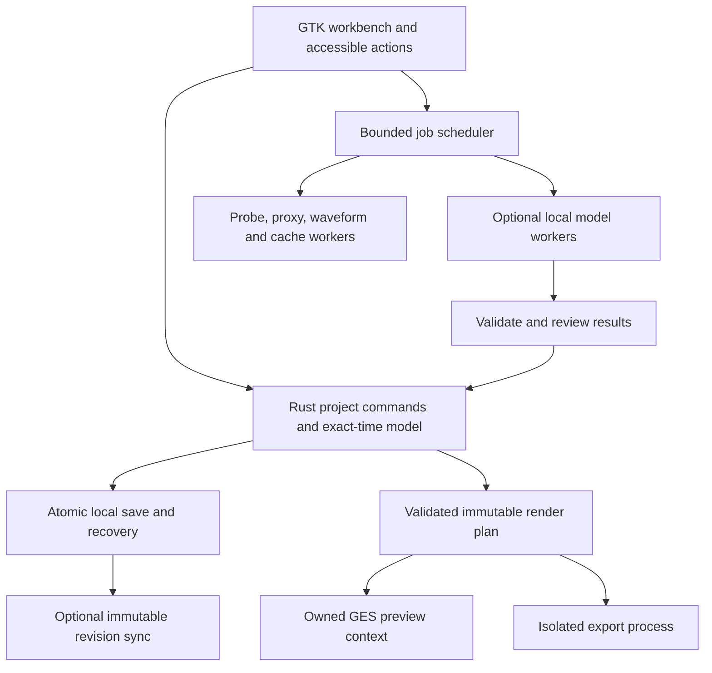

# t-cut: master plan

> **For agentic workers:** REQUIRED SUB-SKILL: Use superpowers:subagent-driven-development (recommended) or superpowers:executing-plans to implement this plan task-by-task. Steps use checkbox (`- [ ]`) syntax for tracking.

## At a glance

- **Product:** free, open-source, Linux-first video editor. CapCut-familiar workflow. Original brand.
- **Stack:** Rust owns the project. GTK4 draws the UI. GStreamer/GES plays and renders, once Phase 0 qualifies it.
- **Status:** plan only. Nothing is implemented. No CapCut parity claim. No trademark clearance.
- **Baseline:** planning 2026-10-11, finalized 2026-10-12.
- **Start with:** [release roadmap](release-roadmap.md), then T01 in the [starter plan](starter-plan.md).

## Global constraints

- [ ] Free, offline core. No account, subscription, watermark, ads, or paid unlocks.
- [ ] Original code is GPL-3.0-or-later. Audit dependencies, models, and assets separately.
- [ ] "Mostly Rust" does not mean every codec, GUI library, or runtime is pure Rust.
- [ ] Keep the familiar layout and workflow. Copy no CapCut code, branding, icons, catalog assets, or models.
- [ ] Saving, recovery, exact timing, and preview/export match are core requirements.
- [ ] No hidden cloud fallback, silent loss of effects, fake output, or unmeasured claims.
- [ ] Full-scope rules in the product spec apply even when work is staged.

## Read in this order

| # | Document | What it covers |
|---|---|---|
| 1 | [Product spec](product-spec.md) | Audience, scope, 40 feature families, 12 workflows, acceptance gates |
| 2 | [Release roadmap](release-roadmap.md) | **Authoritative** version scope, MVP acceptance, task ownership |
| 3 | [UI contract](ui-contract.md) | Layout, panes, timeline modes, gestures, shortcuts, accessibility |
| 4 | [CapCut UI research](../research/research.md) | Screen study, 28 screenshots, reference cohorts, gaps |
| 5 | [Fidelity contract](../research/fidelity-contract.md) | Home and project lifecycle, 24 screen states, 14 scenarios |
| 6 | [UI wireframe (historical)](ui-layout.svg) | Old concept, **superseded** by the screenshot research |
| 7 | [Architecture](architecture.md) | Crates, time model, project format, media pipeline, jobs, AI contracts |
| 8 | [Starter plan](starter-plan.md) | Toolchain, local prerequisites, 12 fixtures, first vertical slice |
| 9 | [Implementation](implementation.md) | 40 work packages with dependencies, paths, steps, checks |
| 10 | [Quality and release](quality-release.md) | Corpus, budgets, AI evaluation, security, a11y, Flatpak, CI |
| 11 | [Sources](sources.md) | Primary references, claim limits, evidence labels |

> Paths in implementation tasks point at a **future new repository**. This plan lives apart from PhotoCraft and sibling repos. No existing clone is the foundation just because it is Rust.

## Decisions to start with

| Decision | Recommendation | Why, and what must be checked |
|---|---|---|
| Scope | Linux desktop first. Track every creator family. | Mobile, web, and proprietary services are not treated as desktop parity. |
| License | GPL-3.0-or-later | Strong freedoms. Audit still required. |
| UI toolkit | GTK4 via Rust bindings | Native Linux integration, accessible controls, GLib media hooks |
| Authoritative state | Rust domain model, typed commands, exact time | Project correctness does not depend on widget or GES state |
| Media engine | GStreamer/GES, **conditional** on T01 | Hard timing, retime, and nesting paths must pass. Else evaluate MLT. |
| Fallback | Evaluate MLT if GES fails hard requirements | Pick one backend. Do not keep two by default. |
| GPU | Native negotiated video path first | `wgpu` is not an NLE engine. Avoid extra copies and a second compositor. |
| AI | Optional, local, versioned, rights-audited packs | User control and reproducibility. No blanket license assumptions. |
| Project format | Open versioned folder, atomic snapshot and journal | Recoverable, portable, cache-independent |
| Packaging | Flatpak first | Test portals, drivers, and codecs for real |
| Services | Optional, self-hostable where feasible | Free software does not mean free hosted GPU or storage |

<strong>Verified dependency family and native floors</strong>

Starter release family, checked against manifests: GTK Rust **0.10**, GLib/GIO **0.21**, GStreamer/GES Rust **0.24**, GTK sink **0.14**.

Proposed native floors: GTK **4.14**, GStreamer/GES **1.26**.

Use patched releases, committed lockfiles, advisory checks, and a maintained runtime. This does not claim the family is the newest or production-qualified.

## Interface target

Keep the familiar mental model:

- Home dashboard with project cards, Create, Open, and manage.
- Library and media tools on the left.
- Player in the center.
- Selection-aware properties on the right.
- Multitrack timeline below.
- Export at the upper right.

The hard part is **behavior**, not panel placement. Snapping, magnet and ripple, links, trim and split, keyframes, text focus, undo, and export ranges must be predictable. The [UI contract](ui-contract.md) defines them and separates documented CapCut behavior from our own choices.

Match the reference hierarchy, control grouping, and workflows through independent implementation. Use t-cut branding and original or licensed assets. Omit mandatory accounts and paid unlocks. Final presentation and interoperability still need legal review. No clearance is claimed.

## Runtime structure

- The project is **never** a pile of GUI properties or live engine handles.
- AI and service responses **cannot** rewrite the project directly.
- Every accepted edit goes through validated commands with undo and recovery.

## Build order and stopping gates

- [ ] **1. Qualify the engine.** Real Rust preview and render. Check frame and sample boundaries, VFR, reverse, speed curves, nesting, color, and ownership. Resolve the 121-frame result, do not ignore it.
- [ ] **2. Make the local MVP safe end to end.** Home, create, open, import, split, trim, move, basic canvas, title, music, undo, save, reopen, export. Prove recovery and offline use. Covers T02 to T08, the T10/T18/T19 basic slices, and early T37 to T40.
- [ ] **3. Expand everyday editing.** Full snap, magnet, and link modes. Static geometry, text, and audio. Manual captions. Layout, accessibility, and settings are MVP work, not polish.
- [ ] **4. Add creator fundamentals.** Transforms, keyframes, speed, compounds, transitions, masks, color, text, audio, captions.
- [ ] **5. Add evaluated local intelligence.** Tracking, cutout, cleanup, translation, transcript edits, TTS, restoration, highlights, storyboards.
- [ ] **6. Add extended workflows.** Original templates and covers, generation and avatars, documented interchange, optional sync, review, and publishing.
- [ ] **7. Qualify releases.** Installed package, hardware and driver matrix, accessibility, data safety, licenses, and an honest capability ledger.

> This is a **dependency order**, not a date promise. Some work starts early and closes later. Accessibility, security, and packaging begin with the first slice. T31's template core comes before T27 storyboards. T17's AI retouch closes after T23. Services never block local editing.

## Scope completeness

The feature registry maps **F01 to F40** to **T01 to T40**. It covers:

- Import, library, proxies, timeline modes, nesting, multicam, recording.
- Transforms, keyframes, speed, transitions, masks, color, HDR, effects, retouch.
- Typography, captions, transcript editing, translation, deterministic and AI audio cleanup.
- Tracking, reframe, matting, inpainting, TTS, cloning, dubbing, generation, restoration, search, storyboards.
- Original templates, covers, exports, native projects, interchange, and bounded CapCut import research.
- Optional sync, review, live collaboration, and publishing.
- Linux packaging, privacy, security, accessibility, localization, and governance.

> This is planned coverage, **not** a claim that every CapCut function or catalog item was listed or can be copied exactly. Keep a pinned-build parity ledger. New requirements go through explicit scope review.

## Evidence gates

| Gate | What resolves it | What can still be built meanwhile |
|---|---|---|
| Exact CapCut compatibility | Lawfully obtained, pinned desktop build, recorded behavior | Common workflows with proposed defaults |
| GES hard paths | T01 corpus, independent output checks, ownership and performance data | Domain API, original UI spec |
| Native dev metadata | Install qualified SDK packages at implementation start | Planning, domain work, corpus spec |
| Model rights and quality | Exact license audit, real multilingual and hardware tests | Manual editing and deterministic effects |
| HDR and GPU claims | Real pipeline, display, driver, and profile tests | Honest SDR, proxy, and software paths |
| Draft compatibility | Lawful fixtures, per-version semantic comparison | Native format, OTIO, subtitles |
| Platform publishing | Official API credentials and approval, allowed test uploads | Local export and open-folder flow |
| Managed service costs | Funding, infrastructure, operating policy | Self-hosted and offline product |
| Public identity | Name and trademark review, final presentation | Neutral working name, original design system |

## First assignment

1. Do **T01** from the [starter plan](starter-plan.md). This is not full app generation.
2. Deliver a Rust and GTK media qualification app and a measured backend decision.
3. Then follow the [MVP integration order](release-roadmap.md): T02 to T08, the T10/T18/T19 basic slices, and release-scoped T37 to T40.
4. Each feature needs real failure cases and an actual smoke run before it is advertised.

> Do not download large models, start services, or touch PhotoCraft just to start. Keep the new repo independent, contracts small, and shared schema changes under one owner.

<strong>Historical check: original package (2026-10-11)</strong>

Checked before the 2026-10-12 UI research addendum. The counts describe that package only.

- Eight Markdown documents and one independently authored SVG wireframe.
- All 40 feature IDs have task owners. All 40 tasks list dependencies, file paths, steps, and checks.
- All 25 local Markdown links resolved. Code fences balanced. Both starter TOML examples parsed.
- Prerequisite references form an acyclic graph. Security and accessibility tasks separate early prerequisites from final closure.
- SVG parsed, has title and description, no script or `foreignObject`. Rendered and inspected in Chromium. It is a concept, not a working editor.

Not run then: no new-editor build, product tests, GPU benchmark, model inference, or CapCut desktop test. Those are explicit implementation gates.

<strong>Finalization check (2026-10-12)</strong>

- 12 planning and research Markdown documents. All 56 local links resolve. Code fences balance.
- All 40 tasks keep dependencies, paths, steps, and checks. Every prerequisite names a real task. The graph is acyclic.
- All 40 feature families map to owner tasks. The roadmap ownership table covers T01 to T40.
- The roadmap defines v0.1 to v1.0 plus post-1.0, and the T10, T18, T19, T20, and T31 early slices. Both starter TOML examples parse. No TBD, TODO, or FIXME remain.
- The 28-screenshot reference manifest is intact.

This validates plan structure and consistency. **No** application was built, **no** engineering gate passed, and **no** CapCut desktop build was run.

