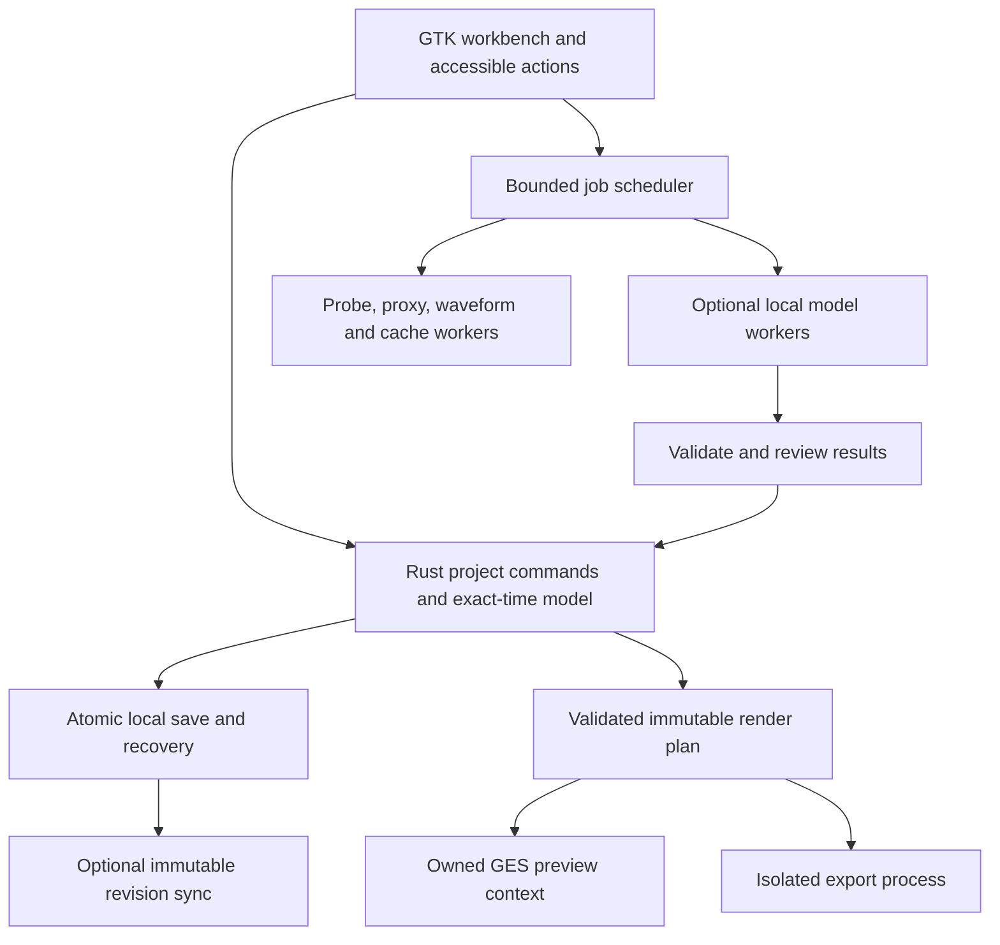

# t-cut: Free and Open-Source Linux Video Editor Implementation Plan

> **For agentic workers:** REQUIRED SUB-SKILL: Use superpowers:subagent-driven-development (recommended) or superpowers:executing-plans to implement this plan task-by-task. Steps use checkbox (`- [ ]`) syntax for tracking.

**Goal:** Build a free/open-source, Rust-led Linux video editor with a CapCut-familiar desktop workflow, independent branding and a comprehensive creator-tool roadmap.
**Architecture:** Rust owns exact project/edit semantics; GTK4 provides the native workbench; a qualified GStreamer/GES backend provides playback/rendering; isolated workers provide export/AI; optional self-hostable services do not gate local editing.
**Tech Stack:** Rust 2024; matched GTK4/GLib/GStreamer/GES Rust bindings; native media/text stack; versioned local projects; optional rights-audited models; Flatpak-first distribution.
**Spec:** [Product specification](product-spec.md).

Planning baseline: **2026-10-11**. User-selected product name: **t-cut**. Earlier `LCE`/`lce-*` identifiers remain internal planning names, not the public brand. The **2026-10-12 [screenshot-backed UI research](../research/research.md)** supersedes the generic layout concept: Home, project opening and the complete familiar local application journey are MVP requirements. This package is a plan, not an implemented application, complete CapCut parity claim or trademark clearance.

**Finalized execution baseline: 2026-10-12.** The [release roadmap and MVP contract](release-roadmap.md) defines v0.1–v1.0 and post-1.0 boundaries, dependency-safe early text/audio/geometry slices, release blockers and the implementation handoff. Read it before scheduling tasks. Finalized means the plan is ready to execute, not that engineering qualification gates have passed.

## Global Constraints

- Free, open-source, offline-capable core; no mandatory account, subscription, watermark, ads or paid feature unlocks.
- Adopt GPL-3.0-or-later as the original application-code license baseline; audit third-party dependencies and model/asset licenses separately.
- Primarily Rust does not mean every codec, GUI library and inference runtime must be pure Rust.
- Preserve recognizable editor layout and workflows without copying CapCut code, branding, icons, catalog assets or proprietary models.
- Save/recovery, correct timing, undo and preview/export equivalence are foundational requirements.
- No hidden cloud fallback, silent loss of effects, counterfeit output, or unmeasured quality/performance claims.
- All detailed constraints in the product specification apply. Staging work does not remove full-scope requirements.

## 1. Read the package in this order

| Document | What it specifies |
|---|---|
| [Product specification](product-spec.md) | Audience, boundaries, 40 feature families, 12 workflows, acceptance and unresolved evidence gates |
| [Final release roadmap and MVP contract](release-roadmap.md) | Authoritative version scope, exact MVP acceptance, early feature slices, task/release ownership and handoff |
| [UI and interaction contract](ui-contract.md) | Familiar layout, pane behavior, timeline modes, gestures, inspector, shortcuts, captions, keyboard/IME/accessibility |
| [Detailed CapCut UI research](../research/research.md) | Screen-by-screen study, 28 directly inspected screenshots, reference cohorts and exactness gaps |
| [t-cut interface fidelity contract](../research/fidelity-contract.md) | Home/project lifecycle, 24 screen states, MVP obligations and actual-interaction acceptance scenarios |
| [Earlier generic workspace wireframe](ui-layout.svg) | Historical concept only; superseded as the fidelity target by the screenshot-backed research |
| [Architecture and stack](architecture.md) | Concrete dependency family, alternatives, crate ownership, time, project format, media pipeline, jobs, AI/license contracts |
| [Starter implementation plan](starter-plan.md) | Initial manifest/toolchain, local prerequisites, 12 qualification fixtures, first editable/exportable vertical slice |
| [Full implementation plan](implementation.md) | 40 work packages with dependencies, exact future paths, implementation steps and verification scenarios |
| [Quality and release plan](quality-release.md) | Corpus, performance budgets, AI evaluation, security, a11y, Flatpak/GPU matrix, CI, governance and release blockers |
| [Source and evidence ledger](sources.md) | Primary references, claim limits, documented versus observed versus proposed decisions |

Paths inside implementation tasks refer to a **future new repository**, ``. This planning package is stored separately from the existing PhotoCraft/sibling repositories. No existing clone is selected as the new product's foundation merely because it is written in Rust.

## 2. Decisions to start with

| Decision | Recommendation | Reason / qualification |
|---|---|---|
| Product scope | Linux desktop first; all creator feature families tracked | Mobile/web navigation and proprietary services are not silently equated with desktop parity |
| Application license | GPL-3.0-or-later | Strong user freedoms, compatible strategy for many mature FOSS components; exact audit still required |
| UI toolkit | GTK4 through Rust bindings | Native Linux integration, accessible controls, GLib integration with media |
| Authoritative state | Rust domain model, typed commands, exact time | Avoid coupling project correctness to widget or GES state |
| Media engine | GStreamer/GES, conditionally accepted after T01 | Existing media infrastructure; difficult timing/retime/nesting paths must qualify |
| Fallback decision | Evaluate MLT if GES fails hard requirements | Select one backend before downstream investment; do not maintain two by default |
| GPU approach | Native negotiated video path first | `wgpu` is not an NLE engine; avoid unnecessary frame copies/second compositor |
| AI | Optional local, versioned, rights-audited model packs | Offline user control and reproducibility; no blanket license assumptions |
| Project format | Open versioned project folder, atomic snapshot/journal | User-owned recoverable edits, cache independence and portability |
| Packaging | Flatpak first | Repeatable native stack; actual portal/driver/codec behavior must be tested |
| Services | Optional and self-hostable where feasible | Free software does not imply free unlimited hosted GPU/storage |

Starter release family verified against manifests: GTK Rust **0.10**, GLib/GIO **0.21**, GStreamer/GES Rust **0.24**, GTK sink **0.14**. Proposed native floors: GTK **4.14**, GStreamer/GES **1.26**. Use patched releases, committed lockfiles, advisory checks and a maintained runtime; these are not assertions that the selected family is newest or already production-qualified.

## 3. Interface target

Retain the familiar mental model:
- Home dashboard, project cards and Create/Open/manage-project workflows.
- Library/media tools on the left.
- Video player in the center.
- Selection-aware properties on the right.
- Multitrack timeline below.
- Export at the upper right.

The hard part is behavior, not panel placement: clip selection, snapping, magnet/ripple, links, trim/split, keyframes, text focus, undo and export ranges must be predictable. The UI contract defines these precisely and distinguishes documented CapCut behavior from our own choices.

Closely match the reference application's screen hierarchy, control grouping and workflows through independent implementation. Use t-cut branding and original/licensed icons, artwork, presets and other assets; omit mandatory accounts and paid unlocks. Do not interpret independent branding as permission to substitute a generic editor layout. Final presentation and interoperability methods still need appropriate legal review; no clearance is claimed here.

## 4. Runtime structure

The authoritative project never becomes a loose collection of GUI properties or mutable engine handles. AI and service responses cannot directly rewrite it. Every accepted edit goes through validated commands and undo/recovery semantics.

## 5. Build order and stopping gates

1. **Qualify the engine.** Real Rust preview/render; frame/sample boundaries, VFR, reverse, speed curves, nesting, color and ownership. Resolve the earlier observed 121-frame nominal four-second result rather than ignoring it.
2. **Make the familiar local MVP safe end to end.** Home → create/open → import → split/trim/move → basic canvas/title/music → undo → save/reopen → export; prove recovery and offline behavior. T02–T08 plus T10/T18/T19 basic slices and early T37–T40 deliver this release.
3. **Expand everyday workflow semantics.** Complete snap/magnet/link modes, static geometry/text/audio and manual captions. Familiar application layout, accessible controls and settings already exist in the MVP; they are not deferred polish.
4. **Add creator fundamentals.** Transforms, keyframes, speed, compounds, transitions, masks, color, text, audio and captions.
5. **Add evaluated local intelligence.** Tracking, cutout, cleanup, translation, transcription edits, TTS, restoration, highlights and storyboard assistance.
6. **Add extended workflows.** Original templates/covers, generation/avatars, documented interchange and optional sync/review/publishing.
7. **Qualify releases.** Actual installed package, hardware/driver matrix, accessibility, data safety, source/licenses and truthful capability ledger.

This is a dependency order, not a promise of completion dates. Some tasks have early contracts and later closure: accessibility/security/packaging begin with the first slice; the template schema/core from T31 precedes storyboard assembly in T27; AI-dependent retouch in T17 closes after T23. Services must not block local editing.

## 6. Scope completeness

The feature registry maps F01–F40 to T01–T40. It covers:

- Import/library/proxies; timeline modes, nesting, multicamera and recording.
- Transform/keyframes/speed; transitions/masks/color/HDR/effects/retouch.
- Typography/captions/transcript editing/translation; deterministic audio and AI cleanup.
- Tracking/reframe/matting/inpainting; TTS/cloning/dubbing; generation/restoration/search/storyboards.
- Original templates, covers, exports, native projects, interchange and bounded CapCut import research.
- Optional sync/review/live collaboration/publishing.
- Linux packaging, privacy, security, accessibility, localization and open-source governance.

This is comprehensive planned coverage, not a claim that every undocumented CapCut function or proprietary catalog item has been enumerated or can be replicated identically. Maintain a pinned-build parity ledger and add newly observed requirements through explicit scope review.

## 7. Evidence gates and external prerequisites

| Gate | What resolves it | Work that remains independently actionable |
|---|---|---|
| Exact CapCut compatibility | Lawfully obtained pinned desktop build and recorded behavior | Implement documented/common workflows with proposed defaults |
| GES hard-path qualification | T01 corpus, independent output checks, ownership/performance measurements | Domain/API and original UI specification |
| Missing native dev metadata | Install qualified SDK/dev packages when implementation starts | Planning, domain development, corpus specification |
| Model rights/quality | Exact artifact license audit and real multilingual/hardware evaluation | Manual editing and deterministic effects remain available |
| Full HDR/GPU claims | Actual pipeline/display/driver/profile tests | Honest SDR/proxy/software paths |
| Draft compatibility | Lawful representative fixtures and per-version semantic comparison | Native format, OTIO and subtitles |
| Platform publishing | Official API credentials/approval and allowed test uploads | Local export and open-folder workflow |
| Managed service costs | Funding, infrastructure and operating policy | Optional self-hosted and offline-local product |
| Public identity | Name/trademark and final presentation review | Neutral working designation and original design system |

## 8. First implementation assignment

Start with **T01 in the starter plan**, not full app generation. Its deliverable is a working Rust/GTK media qualification application plus measured backend decision. Then execute the [MVP integration order](release-roadmap.md): T02–T08, the real T10/T18/T19 basic slices and release-scoped T37–T40. Each feature needs meaningful failure cases and an actual smoke run before its capability is advertised.

Do not download large models, initialize services, or modify PhotoCraft merely to start the new editor. Keep the new repository independent, keep contracts small, and integrate shared schema changes under one owner.

## 9. Original planning-package verification (2026-10-11)

Historical checks before the 2026-10-12 UI research addendum; the counts below describe that original package:

- Eight Markdown documents and one independently authored SVG wireframe.
- All 40 feature-family IDs have valid task owners; all 40 implementation tasks include dependencies, file paths, implementation steps and verification instructions.
- All 25 local Markdown links resolve; Markdown code fences balance and both starter TOML examples parse.
- Declared prerequisite references form an acyclic graph. Cross-cutting security/accessibility tasks distinguish early prerequisites from final release closure; this is not evidence that product tasks are completed.
- SVG XML parses, contains title/description and no script/foreignObject; its layout was rendered and visually inspected in Chromium. The concept is not a functioning editor.

No new-editor application build, product test suite, GPU benchmark, model inference, or current CapCut desktop interaction test was run. Those remain the explicit implementation gates, not hidden gaps in a completion claim.

## 10. Finalization verification (2026-10-12)

Checked after adding the release roadmap and MVP contract:

- 12 planning/research Markdown documents; all 56 local links resolve and all code fences balance.
- All 40 tasks keep dependencies, file paths, steps and verification; every declared prerequisite names a real task and the prerequisite graph is acyclic.
- All 40 feature families map to existing owner tasks; the roadmap's release-ownership table covers every task T01–T40.
- The roadmap defines v0.1–v1.0 plus post-1.0 scope and the T10/T18/T19/T20/T31 early slices; both starter TOML examples parse; no TBD/TODO/FIXME placeholders remain.
- The 28-screenshot reference manifest is intact.

This validates plan structure and internal consistency. No application was built, no engineering gate was passed, and no CapCut desktop build was executed.
