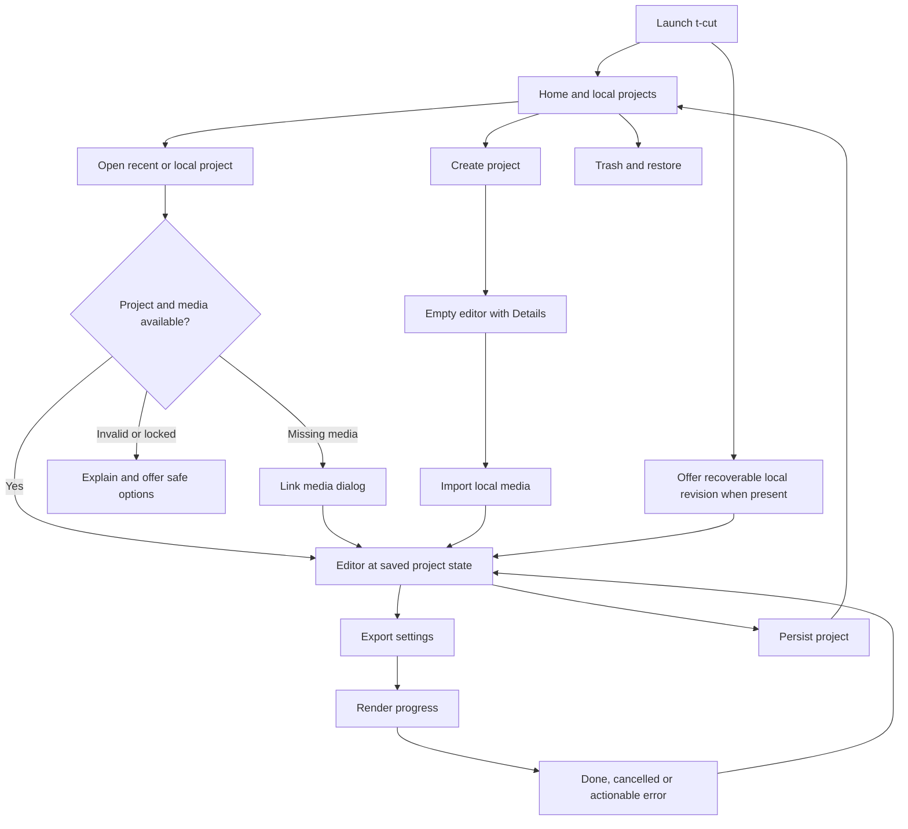

# t-cut Interface Fidelity Contract

Date: **2026-10-12**. Evidence: [research.md](research.md). Images: [screenshot-index.md](screenshot-index.md).

This is a **specification**, not a working prototype.

## At a glance

- **Target:** a t-cut desktop app that feels like CapCut Desktop to its users. Same screens, panel layout, navigation, control placement, and editing flow.
- **Not the target:** exact pixels, current-build parity, or legal clearance. Public screenshots cannot prove those.
- **Scope:** all 24 screen states (UI01–UI24) and 14 acceptance scenarios (A01–A14).
- **MVP:** real working surfaces only. No fake or disabled controls to imitate a screenshot.
- **Unverified details** stay proposed t-cut decisions until a pinned reference build confirms them.

## 1. What "looks and works like CapCut" means

**User requirement:** closely reproduce the recognizable layout and workflow, including Home and opening projects. A different-looking generic editor is not acceptable.

t-cut must keep:

- Screen hierarchy
- Panel relationships
- Navigation grouping
- Control placement
- Visual density
- Object selection model
- Ordinary editing sequence

t-cut uses its own brand and original or licensed assets.

**Precedence:** research evidence overrides the earlier generic wireframe for screen layout. Earlier time, model, save, and security contracts still apply.

## 2. Required screen inventory

IDs are stable acceptance references.

**MVP** means a real working surface, not a fake modal or disabled mock. Later tools must join the existing layout without a redesign.

| ID | Screen or state | Reference | MVP requirement |
|---|---|---|---|
| UI01 | Home with projects | S01 | Left navigation, prominent Create project, Projects header and tools, thumbnail cards |
| UI02 | Home without projects | UI01 structure. Empty state proposed. | Same shell, clear Create and Open actions, no login gate |
| UI03 | Project-card menu | S24 | Working Rename, Duplicate, Move to Trash. Keyboard route. |
| UI04 | Delete confirmation and Trash | S25. Trash contents unverified. | Confirmation, real local Trash and Restore, source files retained |
| UI05 | Create or open progress and failure | Route documented | Enter editor directly. Explicit loading, error, and read-only states. |
| UI06 | Empty editor | S02, S09 | Full editor frame, Import drop zone, Player, Details and Modify, empty timeline |
| UI07 | Imported media browser | S15, S21 (supplemental) | Import and search, asset grid, thumbnails and durations, usable source preview |
| UI08 | Selected video | S03 | Contextual Video and Basic controls, player handles, selected clip outline |
| UI09 | Selected audio | S06, S16 | Familiar Basic layout with working volume and fades. Processing later. |
| UI10 | Selected text | S05, S10 | Familiar text area, font, and style controls. On-canvas selection. Advanced animation later. |
| UI11 | Timeline edit states | S03, S05, S06, S22 | Playhead, ruler, track controls, selected, multi-selected, and locked states. Undo, trim, split, move. |
| UI12 | Preset and catalog browser | S03, S04 | Keep the slot and navigation pattern. Only working tools ship. |
| UI13 | Auto-caption creation | S05 | Later, engine-backed. Keep the left category and right text-inspector relationship. |
| UI14 | Speed and keyframe editors | S15, S21 | Later feature depth. Do not confuse speed, easing, and color curves. |
| UI15 | Color inspector | S17–S20 | Later feature depth. Known main and subtab hierarchy. |
| UI16 | Export settings | S07 | Two-column preview and settings modal. Real destination. Tested profile. |
| UI17 | Export running, done, failed, cancelled | Setup reference only. Detailed states proposed. | All required. No fake percentages. No success before valid output. |
| UI18 | Global Settings | S26 | Familiar tabbed modal with real local preferences. No unsupported service controls. |
| UI19 | Project Modify | Entry in S02. Full modal unverified. | Working project name, format, and media policy. Exact layout gated on evidence. |
| UI20 | Shortcut settings | Behavior documented. Readable dialog unverified. | Working, discoverable bindings and remapping. Exact layout gated on evidence. |
| UI21 | Missing-media relink | S27 (historical desktop) | Missing-file table and status. Locate, relink, cancel. Edits survive. |
| UI22 | Return Home and reopen | Route documented | Preserve edits. Show saved project card. Reopen the correct project. |
| UI23 | Workspace sizing and reset | S23 (historical preset menu) | Resizable panes and reset. More named presets later. |
| UI24 | Recovery after interruption | No verified current CapCut recovery screenshot | Working t-cut recovery flow, labeled as our design, not a copy |

**Rules:**

- The MVP includes the whole local application workflow, not every catalog or AI function.
- An unimplemented feature must not appear to work.
- Keep the layout regions and tool order for available tools.
- Do not fill regions with disabled controls just to match a screenshot.

## 3. Navigation and lifecycle

This diagram specifies **t-cut behavior**. It does not claim CapCut uses the same internal state machine.

### Home actions

- **Create project:** makes one valid managed project identity and opens the empty editor. No naming or format wizard first.
- **Open recent:** uses the card's stable project identity, not a list index. A missing path gets a locate or remove-from-recent choice. Never silently create a blank replacement.
- **Open project:** lets a Linux user pick a portable project. Keep it easy to find near creation or navigation. Do not claim its placement matches verified CapCut UI.
- **Rename:** updates the display title and card state. Decide path changes separately. Never move source media without warning.
- **Duplicate:** creates a new project identity with independent edits. It may share read-only source files. Say clearly that it is not a full media backup.
- **Move to Trash:** affects the managed project, not arbitrary original footage. Keep a restore record. Proposed policy: keep until explicit permanent deletion. Show that policy, not the reference's 30-day message.
- **Trash:** supports restore and confirmed permanent deletion. Show item identity and location before deletion.
- **Return Home:** waits for, or visibly reports, the durable-save outcome. A save failure must not be hidden by navigation.

### Local settings vs project settings

- **Global defaults** affect new projects or app behavior.
- **Project settings** affect the open project's sequence and media policy.
- A current project's frame-rate change must show its timing effects. It should be undoable where supported.
- A global language change must not change project captions or media.

## 4. Layout contract

### Default editor topology

1. Full-width application and title bar.
2. Upper workspace with three sibling panes: library, Player, contextual properties.
3. Inside the library: horizontal main-tool strip, then an inner category column and a content area.
4. Full-width timeline toolbar below the upper workspace.
5. Ruler and track body. Track headers fixed at left. Timeline content scrolls horizontally.

**Placement:**

- Undo and redo: left group of the timeline toolbar.
- Export: toward the upper right of the application bar.
- No-selection Details: right pane.

Move these only for an explicit, accessible compact mode. Never move them to suit an unrelated dashboard template.

### Proportions and resizing

- Use S03's estimated proportions as the first comparison target, at its reference dimensions. Do not hard-code universal pixels.
- Match region boundaries before styling icons and text.
- The reference library is a substantial panel with two navigation levels.
- Splitters must work by keyboard as well as by drag. Keep a Reset layout command.
- Store user layout separately from the project document. Do not restore off-screen coordinates from another monitor.
- At narrow widths, allow library toolbar overflow before reordering categories. Scroll content areas independently.
- At 200% text scaling, keep controls readable and focusable. Document compact-mode differences. Exactness is not a reason to make the product unusable.
- Do not infer minimum sizes or default splitter positions from one screenshot. Find constraints in a working prototype and record them as t-cut decisions.

### Home topology

- Keep left navigation separate from the creation and projects content.
- Keep Create project visually dominant. Project cards go below it.
- Keep search, view, and Trash controls aligned with the Projects heading.
- Monetization and remote-service areas may be omitted. Omitting them must not move core tasks to unrelated menus.

## 5. Inspector state contract

**Conceptual state fields** (not a required framework abstraction):

- `library_category`
- `library_subcategory`
- `selection`
- `inspector_tab`
- `inspector_subtab`
- `inspector_scroll`
- `player_mode`
- `timeline_zoom`
- `timeline_scroll`

| Trigger | Required result | Must not happen |
|---|---|---|
| Open empty project | Details and Modify appear on the right | Stale controls from the previous project |
| Select video clip | Video-compatible tabs and values | Library browser resets unnecessarily |
| Select audio clip | Audio Basic, voice, and speed grouping, as implemented | Video-only transforms shown as editable |
| Select title or caption | Text-compatible controls and canvas selection | Printable keys trigger timeline edits |
| Click Filters or Transitions on the left | Browser content changes | Timeline selection silently changes |
| Change inspector subtab | Relevant controls and scroll context | Clip loses selection or keyframe state |
| Multi-select | Shared properties, or a clear mixed state | First clip's values shown as common values |
| Lock an affected track | Editing commands blocked, with a reason | Inspector bypasses the track lock |
| Undo or redo | Correct state across model, preview, and fields | Only the visible widget value changes |
| Open another project | Discard stale async UI events | Old thumbnails or job results attach to the new project |

## 6. Shared component anatomy

These components express observed grouping. Code and assets are independently authored.

### ToolCategoryStrip

- Horizontal: icon above label.
- Selected state, overflow affordance, focus outline, accessible category name.
- Stable order for available categories.
- No account required to enter local Media, Text, or Audio.
- Do not replace it with a full-height icon rail.

### CategoryList

- Vertical navigation inside the current library category.
- Optional disclosure rows and nested categories.
- Keep each category's selected child when useful.
- Show a clear active item. Do not rely on accent color alone.

### AssetGrid and AudioList

- **Grid:** thumbnail, label, duration or type where it applies, download, ready, or failed state, keyboard insert action.
- **Audio list:** artwork, title, secondary metadata, preview, add, favorite where implemented.
- No premium diamond in a free catalog.

### ParameterRow

- Label, slider or field, numeric value and unit, optional stepper, reset and keyframe controls.
- Stable right-side column for animation controls.
- Mixed values and invalid input have explicit states.
- Escape cancels an uncommitted edit.
- One slider drag produces one undo transaction.

### InspectorSection

- Heading, enable or disclosure control where relevant, reset and keyframe group, parameter rows, divider.
- Do not show a checkbox if the section cannot actually be bypassed.
- Disabled states explain whether the capability is missing or the selection is temporarily constrained.

### TimelineClip

- Body depends on media: thumbnails, waveform, or text label.
- Selected outline. Edge handles and hit regions. Source and processing badges where they apply.
- Draw only visible ranges, but expose selected clips through accessible navigation.
- Small clips need numeric trim and move alternatives.

### ProjectCard

- Thumbnail, title, truthful metadata, open action, context menu.
- Thumbnail loading must not delay opening the project.
- Recoverable, missing, or locked status is visible without replacing the grid with an error page.

### ModalShell

- Title, bounded content region, relevant footer buttons, Escape behavior, focus containment and return.
- Variants:
  - Export: two-column.
  - Settings: tabs and scrolling content.
  - Relink: table, status, footer.
- Do not force one identical form on all three.

## 7. Timeline behavior and safeguards

Main-track magnet, snapping, and linkage are **distinct** controls. Keep their visible state and familiar placement. Do not infer edge-case semantics from icon color.

**Before claiming compatibility,** record these scenarios on a pinned CapCut build and on t-cut:

1. Move a clip near another, with snapping on and off, at two zoom levels.
2. Delete middle main-track content, with magnet on and off.
3. Move the main clip with an attached text clip above and music below.
4. Repeat with linkage disabled, then enabled. Verify stored relation vs. selection behavior.
5. Lock an affected track and repeat trim or ripple.
6. Split a clip at the playhead with one selection, multiple selections, and no selection.
7. Drag an edge past source limits. Observe the feedback. Do not assume a clamp policy.
8. Undo a completed drag. Cancel an active drag with Escape.
9. Scrub with mouse hover or preview mode on and off. Tell the hover line apart from the committed playhead.
10. Enter and exit a compound. Preserve parent and child navigation context.

**Until measured:** the existing t-cut model contract gives deterministic, safe behavior and flags intentional differences. A screenshot comparison cannot certify these gestures.

## 8. Export interaction contract

- Open export from the top-right action. Stay in the project.
- Match S07's layout: preview left, settings right, footer.
- Show Name and destination first. Use a Linux folder chooser for location.
- Offer only supported resolution, rate, container, and codec combinations. Explain incompatible combinations.
- Keep **save project** separate from **export media**. Exporting must not be the only way to keep work.
- Freeze the chosen project revision for the job. Later edits do not change that export.
- Show measured progress or an indeterminate stage. Do not invent percent complete or output size.
- Confirm overwrite. Cancel removes only the job's temporary output.
- Success requires finalized, validated media. Offer open file or open folder. No mandatory upload.
- Failure names the stage where possible: source, effect, codec, or storage. Return to an editable project.

**Observed:** only the setup geometry. Progress, completion, and failure styling stays original t-cut design until more reference captures qualify it.

## 9. Acceptance scenarios

These are **future UI checks**, not tests run during research. Each needs real interaction with a running t-cut build. Save a screenshot and an action-and-outcome trace at each checkpoint.

| Check | Steps | Pass condition |
|---|---|---|
| A01 first launch | Launch without account or network, then Create project | Home appears. Editor opens with no wizard or login. All empty-editor regions present. |
| A02 existing project | Home, project card, return Home, reopen | Correct project and saved edits. Card identity and title kept. |
| A03 manage projects | Rename, Duplicate, edit the copy, Trash the copy, Restore | Original unaffected. Restored copy keeps edits. Original media unchanged. |
| A04 import | Empty editor, import several files, place one clip | Familiar browser state. Correct media, player, and timeline content. Correct selection. |
| A05 context | Select video, then audio, then text, then blank timeline | Correct inspector each time. Blank state shows Details. |
| A06 independent panes | Select a clip, then browse Effects, Transitions, Audio | Browsing does not silently change the selection or inspector object. |
| A07 edit controls | Split, trim, move, undo, redo | Familiar timeline toolbar. Exact state restored. Preview follows edits. |
| A08 text focus | Edit a title with IME, Space, arrows, Backspace | Normal text editing. No unintended playback, deletion, or split. |
| A09 layouts | Resize panes and window, restart, Reset layout | Controls usable. Workspace saved where appropriate. Reset matches the reference. |
| A10 settings | Change an app preference, a project setting, a shortcut | Distinct scopes. Cancel reverts drafts. Saved changes take effect visibly. |
| A11 relink | Move a source file, reopen, Link media, pick a replacement | Timeline edits preserved. Failure or cancel stays recoverable. |
| A12 export | Open settings, export, cancel or retry, open output | Correct two-column surface. Validated file. Project stays editable. |
| A13 keyboard | Create, open, import, select, edit, save, export by keyboard | No essential pointer-only operation. Visible focus. Accessible names. |
| A14 data safety | Interrupt during save, then reopen or recover | Clear recovery choice. Last durable state kept. No source damage. |

## 10. Visual comparison protocol

1. **Record the context:** reference cohort, app build if known, OS, locale, scaling, window size, account and capability state, selected object. Record unknown values as unknown.
2. **Match** the t-cut window size and editing state. Use original or owned sample media. Mask differing preview and catalog artwork during structural comparison.
3. **Compare each state separately:** Home, and each major editor state. A correct video inspector does not prove caption or audio correctness.
4. **Compare structure first:** pane boundaries, toolbar positions, category order, inspector hierarchy, field alignment, clip and ruler relationship, modal columns. Decorative details come last.
5. **Exclude from identity scoring:** CapCut branding, proprietary asset thumbnails, premium controls, tutorial red annotations, OS-specific chrome, and intentionally different Linux file dialogs.
6. **Annotate every other difference** as one of: evidence gap, planned intentional difference, accessibility adaptation, or implementation defect. Do not hide differences in a single similarity percentage.
7. **Exercise interactions** after the screenshots. Passing a visual comparison does **not** pass A01–A14.

**Proposed geometry gate:** at a matched reference capture size, major pane boundaries should fall within about **2% of viewport dimensions**, after the user's splitter changes are controlled for. This is a starting review tolerance. It is not an observed CapCut rule or a pixel-identity promise. Use qualitative review for variable text, icons, and dynamic state until a pinned build gives reliable measurements.

## 11. MVP implementation impact

- **Extend task T04.** Do not create a second competing UI workstream.
- **T04 adds:** real Home, project registry, cards and actions, lifecycle navigation, selection-specific inspector states.
- **Other owners:**
  - T02 and T08: save, recovery, relink.
  - T07: export.
  - T05 and T09: timeline editing.
  - T37: reference comparison and accessibility.

**Suggested future paths** (relative to the new application repository):

- `apps/lce-desktop/src/home/{view,project_card,actions,trash}.rs`
- `apps/lce-desktop/src/navigation.rs`
- `apps/lce-desktop/src/dialogs/{settings,project_settings,shortcuts,relink,export}.rs`
- `apps/lce-desktop/src/panels/{library,player,inspector,timeline}.rs`
- `apps/lce-desktop/src/inspector/{details,video,audio,text}.rs`
- `crates/lce-project/src/registry.rs`: real local project identities and recents. Authoritative project content stays in the existing project format.
- `docs/parity/desktop-reference.csv`: screenshot IDs, build or cohort, observed state, t-cut action, intentional differences.

The `lce-*` names are internal plan names, not the public brand. This research does not create or rename application crates. It does not modify PhotoCraft.

**MVP closure:**

- Required: UI01–UI11 and UI16–UI24, at working scope.
- Reserved for later feature depth: UI12–UI15. They keep the correct architecture and navigation. Do not ship false "working" advanced controls.
- Basic text and audio needed for the MVP ship as real slices of their existing feature tasks. Do not postpone them just because the broader task includes advanced tools.

## 12. Intentional differences and open exactness

| Area | t-cut policy | Why |
|---|---|---|
| Branding and content | Own name, icons, samples, presets, licensed assets | Independent product. Rights compliance. |
| Accounts, Pro, ads | No mandatory account, no paid unlock, no promotional clutter | User's free and open-source requirement |
| File and folder dialogs | Native Linux and portal behavior | Working Linux permissions and user expectations |
| Updates | Respect the package manager and Flatpak | Avoid a non-working copied updater |
| Cloud and AI | Optional, explicit permissions, only implemented capabilities | No fake services. No silent upload. |
| Trash retention | Explicit local policy. No copied 30-day promise. | Data safety and honest behavior |
| Accessibility | Usable focus, screen reader, IME, and scaling | Familiarity cannot justify data-loss shortcuts or unreadable controls |
| Unseen screens | Mark proposed details. Collect better evidence. | Do not fabricate exactness |

**Acceptance target:** close desktop familiarity across the whole application. These bounded differences do not allow replacing the requested layout with a generic new design.
