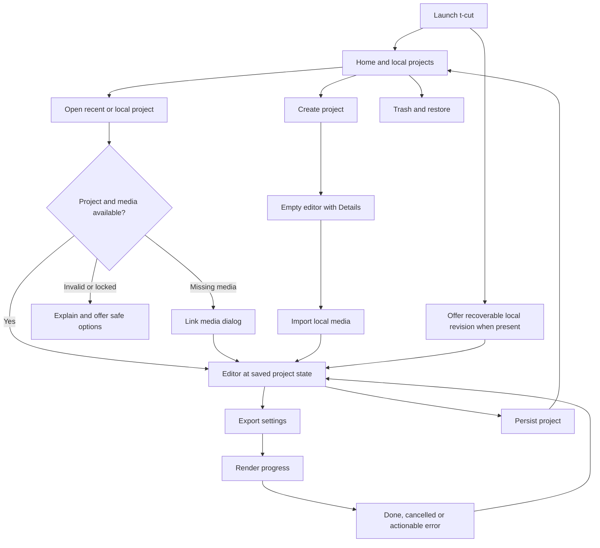

# t-cut Interface Fidelity Contract

Date: 2026-10-12. Read [research.md](research.md) for evidence and [screenshot-index.md](screenshot-index.md) for images. This is a specification, not a functioning prototype.

## 1. What “looks and works like CapCut” means here

User requirement: closely reproduce the desktop application's recognizable layout and workflow, including Home and opening projects. A different-looking generic editor is not an acceptable interpretation.

t-cut must preserve the reference's **screen hierarchy, panel relationships, navigation grouping, control placement, visual density, object selection model and ordinary editing sequence**. It uses its own brand and licensed/original assets. Exact pixel identity, current-build parity and legal clearance are not asserted from public screenshots alone.

Research evidence takes precedence over the earlier generic wireframe for screen layout. Earlier time/model/save/security contracts still apply. Unverified details remain proposed t-cut decisions until a pinned reference build establishes them.

## 2. Required screen inventory

IDs below are stable acceptance references. “MVP” means a real working surface, not a fake modal or disabled mock. Later tools must join the existing layout without forcing a redesign.

| ID | Screen/state | Reference | MVP requirement |
|---|---|---|---|
| UI01 | Home with projects | S01 | Left navigation, prominent Create project, Projects header/tools, thumbnail cards |
| UI02 | Home without projects | UI01 structure; exact empty state proposed | Same shell, clear Create/Open actions, no login gate |
| UI03 | Project-card menu | S24 | Working Rename, Duplicate, Move to Trash flow; keyboard route |
| UI04 | Delete confirmation and Trash | S25; Trash contents unverified | Confirmation, real local Trash/Restore, source files retained |
| UI05 | Create/open progress and failure | Creation/open route documented | Enter editor directly, explicit loading/error/read-only states |
| UI06 | Empty editor | S02/S09 | Complete editor frame, Import drop zone, Player, Details/Modify, empty timeline |
| UI07 | Imported media browser | S15/S21 supplemental | Import/search and asset grid, thumbnails/durations, usable source preview |
| UI08 | Selected video | S03 | Contextual Video/Basic controls, player handles and selected clip outline |
| UI09 | Selected audio | S06/S16 | Familiar Basic layout with working MVP volume/fades; processing later |
| UI10 | Selected text | S05/S10 | Familiar text area/font/style controls and on-canvas selection; advanced animation later |
| UI11 | Timeline edit states | S03/S05/S06/S22 | Playhead, ruler, track controls, selected/multi-selected/locked states, undo, trim/split/move |
| UI12 | Preset/catalog browser | S03/S04 | Preserve slot/navigation pattern; only available working tools ship |
| UI13 | Auto-caption creation | S05 | Later engine-backed feature; retain designated left category and right text-inspector relationship |
| UI14 | Speed and keyframe editors | S15/S21 | Later feature depth; do not confuse speed, easing and color curves |
| UI15 | Color inspector | S17–S20 | Later feature depth; known main/subtab hierarchy |
| UI16 | Export settings | S07 | Two-column preview/settings modal, real destination and tested profile |
| UI17 | Export running/done/failed/cancelled | Setup reference only; detailed states proposed | All required; no fake percentages or success before valid output |
| UI18 | Global Settings | S26 | Familiar tabbed modal with real local preferences; no unsupported service controls |
| UI19 | Project Modify | Entry in S02; full modal unverified | Working project-specific name/format/media policy; exact visual layout gate |
| UI20 | Shortcut settings | Behavior documented; readable dialog unverified | Working discoverable bindings/remapping; exact visual layout gate |
| UI21 | Missing-media relink | S27 historical desktop | Missing-file table/status, locate/relink/cancel; edits survive |
| UI22 | Return Home and reopen | Route documented | Preserve edits, show saved project card, reopen correct project |
| UI23 | Workspace sizing/reset | S23 historical preset menu | Resizable panes and reset; additional named presets later |
| UI24 | Recovery after interruption | No verified current CapCut recovery screenshot | Working t-cut recovery flow, labeled as our design rather than a copy |

The MVP includes the whole local application journey, not every catalog/AI function. An unimplemented advanced feature must not appear to work. Preserve the layout regions and stable ordering of available tools; do not fill them with a wall of disabled controls solely to imitate a screenshot.

## 3. Application navigation and lifecycle

This diagram specifies **t-cut behavior**, not a claim that the exact same internal state machine exists inside CapCut.

### Home actions

- Create project creates one valid managed project identity and opens the empty editor. Do not require a naming/format wizard first.
- Open recent uses the card's stable project identity, not a mutable list index. A missing path gets a locate/remove-from-recent choice, not silent creation of a blank replacement.
- Open project lets a Linux user select a portable project. Keep it discoverable near creation/navigation without claiming its exact placement is verified CapCut UI.
- Rename updates display title and card state; decide path changes separately and never unexpectedly move source media.
- Duplicate creates a new project identity and independent edits. It may share read-only external source files; communicate that it is not automatically a full media backup.
- Move to Trash affects the managed project, not arbitrary original footage. Preserve a restore record. Proposed initial policy: retain until explicit permanent deletion; display that policy rather than the reference's 30-day message.
- Trash supports restore and explicitly confirmed permanent deletion. Show item identity/location so users know what they are deleting.
- Return Home waits for or visibly reports the durable-save outcome. A save failure must not be hidden by navigation.

### Local settings versus project settings

Global defaults affect new projects or app behavior. Project settings affect the open project's sequence/media policy. A current project frame-rate change must show its timing consequences and be undoable where supported. A global language change must not mutate project captions or media.

## 4. Layout contract

### Default editor topology

1. Full-width application/title bar.
2. Upper workspace with three sibling panes: library, Player, contextual properties.
3. Within library: horizontal main-tool strip, then inner category column plus content area.
4. Full-width timeline toolbar below the upper workspace.
5. Ruler and track body, with track headers fixed at the left and timeline content scrolling horizontally.

Undo/redo belong in the left timeline-toolbar group. Export belongs toward the upper-right application bar. No-selection Details belongs in the right pane. Move these only for an explicit accessible compact mode, not to suit an unrelated dashboard template.

### Proportions and resizing

- Use S03's estimated proportions as the first comparison target at its reference dimensions, not hard-coded universal pixels.
- Match region boundaries before styling icons and text. The reference library is a substantial panel with two navigation levels.
- Make splitters keyboard-adjustable as well as draggable. Keep a Reset layout command.
- Preserve user layout separately from the project document; avoid restoring off-screen coordinates from another monitor.
- At narrower windows, permit library toolbar overflow before reordering categories. Scroll content areas independently.
- At 200% text scaling, prioritize readable/focusable controls and documented compact-mode differences. “Exactness” is not a reason to make the product unusable.
- Do not infer minimum dimensions or default splitter positions from one screenshot; determine constraints in a working prototype and annotate them as t-cut decisions.

### Home topology

Keep left navigation separate from the main creation/projects content. Keep Create project visually dominant and project cards beneath the creation area. Keep project search/view/Trash controls aligned with the Projects heading. Monetization/remote-service areas may be omitted; their omission must not move core tasks to unrelated menus.

## 5. Inspector state contract

Maintain independent state for `library_category`, `library_subcategory`, `selection`, `inspector_tab`, `inspector_subtab`, `inspector_scroll`, `player_mode`, `timeline_zoom` and `timeline_scroll`. These are conceptual state fields, not a mandate to create a particular framework abstraction.

| Trigger | Required result | Must not happen |
|---|---|---|
| Open empty project | Details and Modify appear right | Stale controls from previous project |
| Select video clip | Video-compatible tabs and values | Library browser resets unnecessarily |
| Select audio clip | Audio Basic/voice/speed grouping as implemented | Video-only transforms shown as editable |
| Select title/caption | Text-compatible controls and canvas selection | Printable keys trigger timeline edits |
| Click Filters/Transitions left | Browser content changes | Timeline selection silently changes |
| Change inspector subtab | Relevant controls/scroll context | Clip loses selection or keyframe state |
| Multi-select | Shared properties or clear mixed state | Arbitrary first-clip values presented as common values |
| Lock affected track | Editing commands blocked with reason | Inspector bypasses track lock |
| Undo/redo | Correct state across model, preview and fields | Only the visible widget value changes |
| Open another project | Discard stale asynchronous UI events | Old thumbnails/job results attach to new project |

## 6. Shared component anatomy

These components express observed grouping. Their code and assets are independently authored.

### ToolCategoryStrip

Horizontal icon above label, selected state, overflow affordance, focus outline, accessible category name. Stable ordering for available categories; no mandatory account requirement to enter local Media/Text/Audio. Avoid replacing it with a full-height icon rail.

### CategoryList

Vertical navigation within current library category; optional disclosure rows and nested categories. Preserve selected child state per category when useful. Display a clear active item; selection must not depend on accent color alone.

### AssetGrid / AudioList

Grid: thumbnail, label, duration/type where applicable, download/ready/failed state, keyboard insertion action. Audio list: artwork, title, secondary metadata, preview/add/favorite where implemented. No premium diamond copied into a free catalog.

### ParameterRow

Label, slider or field, numeric value/unit, optional stepper, reset and keyframe affordances. Keep a stable right-side alignment column for animation controls. Mixed values and invalid input have explicit states. Pressing Escape cancels an uncommitted edit; dragging one slider produces one undo transaction.

### InspectorSection

Heading, enable/disclosure control where relevant, reset/keyframe group, parameter rows and divider. Do not imitate a checkbox if the section cannot actually be bypassed. Disabled states explain missing capability versus temporary selection constraints.

### TimelineClip

Media-dependent body: thumbnails, waveform or text label; selected outline; edge handles/hit regions; source/processing badges as applicable. Draw only visible ranges but expose selected clips through accessible navigation. Small clips have numeric trim/move alternatives.

### ProjectCard

Thumbnail, title, truthful metadata, open action and context menu. Loading a thumbnail must not delay opening the project. Recoverable/missing/locked status is visible without replacing the whole grid with an error page.

### ModalShell

Title, bounded content region, relevant footer buttons, Escape behavior, keyboard focus containment and return. Export uses a two-column variant. Settings uses tabs and scrolling content. Relink uses a table/status/footer variant. Do not impose one identical form on all three.

## 7. Timeline behavior reference and safeguards

Main-track magnet, snapping and linkage are distinct controls. Preserve visible state and familiar placement. Do not infer exact semantics for all edge cases from cyan icon color.

Before claiming compatibility, record these scenarios on a pinned CapCut build and on t-cut:

1. Move a clip near another with snapping on/off at two zoom levels.
2. Delete middle main-track content with magnet on/off.
3. Move the main clip with an attached text clip above and music below.
4. Repeat with linkage disabled, then enabled; verify stored relation versus selection behavior.
5. Lock an affected track and repeat trim/ripple.
6. Split a clip at the playhead with one selection, multiple selections and no selection.
7. Drag an edge past source limits; observe feedback rather than assuming clamp policy.
8. Undo a completed drag and cancel an active drag with Escape.
9. Scrub with mouse hover/preview mode enabled and disabled; distinguish hover line from committed playhead.
10. Enter/exit a compound and preserve parent/child navigation context.

Until measured, the existing t-cut model contract provides deterministic safe behavior and flags intentional differences. A screenshot comparison cannot certify these gestures.

## 8. Export interaction contract

- Open export from the top-right action without leaving the project.
- Match S07's preview-left/settings-right/footer layout.
- Present Name and destination first; use a Linux folder chooser for location.
- Offer only supported resolution/rate/container/codec combinations, with explanatory incompatibility states.
- Keep save-project separate from export-media. Exporting cannot be the only way to preserve work.
- Freeze the chosen project revision for the job; later edits do not mutate that export.
- Display measured progress or an indeterminate stage; do not invent percent complete or output size.
- Confirm overwrite; cancel removes only the job's temporary output.
- Success requires finalized/validated media. Offer open file/folder without mandatory upload.
- Failure identifies a source/effect/codec/storage stage where possible and returns to an editable project.

Only setup geometry is directly observed. Progress/completion/failure styling remains original t-cut design unless further reference captures qualify it.

## 9. Screen acceptance scenarios

These are future UI checks, not tests executed during research. Each requires actual interaction with a running t-cut build. Save a screenshot and an action/outcome trace at the named checkpoints.

| Check | Steps | Pass condition |
|---|---|---|
| A01 first launch | Launch without account/network → Create project | Home appears; editor opens without a wizard/login; all empty-editor regions present |
| A02 existing project | Home → project card → return Home → reopen | Correct project and saved edits; card identity/title retained |
| A03 manage projects | Rename → Duplicate → edit copy → Trash copy → Restore | Original unaffected; restored copy retains edits; original media unchanged |
| A04 import | Empty editor → Import multiple files → place one clip | Familiar browser state, correct media/player/timeline content and selection |
| A05 context | Select video → audio → text → blank timeline | Correct inspector each time; blank state is Details |
| A06 independent panes | Select clip → browse Effects/Transitions/Audio | Browsing does not silently change selection or inspector object |
| A07 edit controls | Split → trim → move → undo/redo | Familiar timeline toolbar, exact state restoration, preview follows edits |
| A08 text focus | Edit title using IME, Space, arrows, Backspace | Normal text editing; no unintended playback/deletion/split |
| A09 layouts | Resize panes/window → restart → Reset layout | Usable controls, saved workspace where appropriate, reference-like reset |
| A10 settings | Change app preference → project setting → shortcut | Distinct scopes; cancel reverts drafts; saved changes take effect visibly |
| A11 relink | Move source file → reopen → Link media → select replacement | Original timeline edits preserved; failure/cancel remains recoverable |
| A12 export | Open settings → export → cancel/retry → open output | Correct two-column surface; validated file; project remains editable |
| A13 keyboard | Create/open/import/select/edit/save/export with keyboard | No pointer-only essential operation, visible focus and accessible names |
| A14 data safety | Interrupt during save → reopen/recover | Clear recovery choice, last durable state, no source damage |

## 10. Visual comparison protocol

1. Identify reference cohort, app build if available, OS, locale, scaling, window size, account/capability state and selected object. Record unknown values explicitly.
2. Match t-cut window size and editing state. Use original/owned sample media; mask the differing preview/catalog artwork during structural comparison.
3. Compare Home and each major editor state separately. A correct video inspector does not establish caption/audio correctness.
4. Compare pane boundaries, toolbar positions, category ordering, inspector hierarchy, field alignment, clip/ruler relationship and modal columns before decorative details.
5. Exclude CapCut branding, proprietary asset thumbnails, premium controls, tutorial red annotations, OS-specific chrome and intentionally different Linux file dialogs from identity scoring.
6. Annotate every other difference: evidence gap, planned intentional difference, accessibility adaptation or implementation defect. Do not hide differences in a single similarity percentage.
7. Exercise interactions after screenshots. Passing a visual comparison is not passing A01–A14.

Proposed geometry gate: at a matched reference capture size, major pane boundaries within roughly 2% of viewport dimensions after controlling user-resized splitters. This is a starting review tolerance, not an observed CapCut rule or a final pixel-identity promise. Use qualitative review for variable text, icons and dynamic state until a pinned build supplies reliable measurements.

## 11. MVP implementation impact

Extend existing task **T04** rather than inventing a second competing UI workstream. Add real Home, project registry/cards/actions, lifecycle navigation and selection-specific inspector states. Existing **T02/T08** own save/recovery/relink; **T07** owns export; **T05/T09** own timeline editing; **T37** owns reference comparison and accessibility.

Suggested future paths, relative to the new application repository:

- `apps/lce-desktop/src/home/{view,project_card,actions,trash}.rs`
- `apps/lce-desktop/src/navigation.rs`
- `apps/lce-desktop/src/dialogs/{settings,project_settings,shortcuts,relink,export}.rs`
- `apps/lce-desktop/src/panels/{library,player,inspector,timeline}.rs`
- `apps/lce-desktop/src/inspector/{details,video,audio,text}.rs`
- `crates/lce-project/src/registry.rs` for real local project identities/recents; authoritative project content remains in the existing project format.
- `docs/parity/desktop-reference.csv` with screenshot IDs, build/cohort, observed state, t-cut action and intentional differences.

The `lce-*` identifiers are earlier plan-internal names, not the public product brand. This research does not create/rename application crates or modify PhotoCraft.

MVP closure requires UI01–UI11 and UI16–UI24 at their working scope. UI12–UI15 reserve the correct architecture/navigation for later feature depth; do not ship false “working” advanced controls. Basic text/audio implementations needed for the MVP must be included as real slices of their existing feature tasks, not postponed merely because the broader task includes advanced tools.

## 12. Intentional differences and unresolved exactness

| Area | t-cut policy | Why |
|---|---|---|
| Branding/content | Own name, icons, samples, presets and licensed assets | Independent product and rights compliance |
| Accounts/Pro/ads | No mandatory account, paid unlock or promotional clutter | User's free/open-source requirement |
| File/folder dialogs | Native Linux/portal behavior | Working Linux permissions and user expectations |
| Updates | Respect package manager/Flatpak | Avoid a nonfunctional copied updater |
| Cloud and AI | Optional, explicit permissions, only implemented capabilities | No fake services or silent upload |
| Trash retention | Explicit local policy; no automatic copied 30-day promise | Data safety and honest behavior |
| Accessibility | Usable focus, screen reader, IME and scaling | Familiarity cannot justify data-loss shortcuts or unreadable controls |
| Unseen screens | Mark proposed details and collect better evidence | Do not fabricate exactness |

The acceptance target remains close desktop familiarity across the whole application. These bounded differences do not authorize replacing the requested layout with a generic new design.
